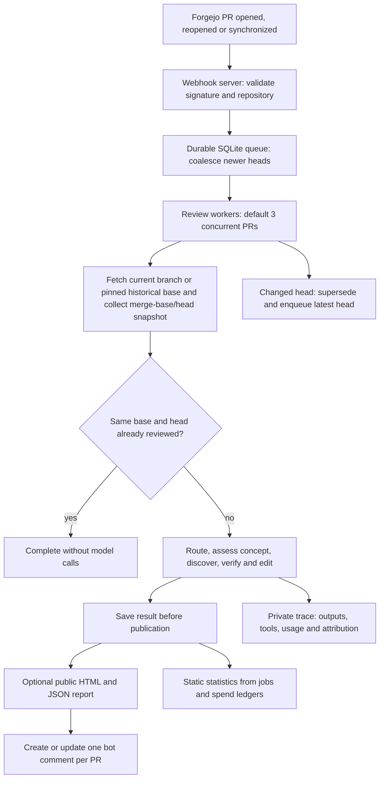

# ralph-service

`packages.<system>.ralph-service` provides the Forgejo webhook service and the
consumers of the [local Ralph review engine](../ralph/README.md). It depends on
the exact core package and imports its `run_review` function directly.

The package installs:

- `ralph-service`, the webhook receiver, queue workers and explicit state converter.
- `ralph-evaluate`, frozen capture/replay, spending inspection and offline summaries.
- `ralph-followup`, background assessment of previously published findings.
- `ralph-telegram`, independent Telegram publication, monitoring and channel commands.

The `ralph` command now performs a local review and accepts no service flags.
Change explicit service package overrides to `packages.<system>.ralph-service`
and manual daemon or migration commands to `ralph-service`. The NixOS module,
`services.ralph` options, systemd unit names and existing state paths keep their
names. See the [module guide](../../modules/ralph/README.md) and
[evaluation guide](../../modules/ralph/evaluation.md).

Core imports and defaults live under the core package's `libexec/ralph`.
Companion code and launchers live under `libexec/ralph-service`; wrappers add the
core Python root without copying its source. Core has no companion dependency.

## Service and review lifecycle



Only one attempt runs per PR. Fetch and snapshot preparation share a Git lock;
model calls run outside it. Each attempt pins its Git objects with separate refs.
Head checks prevent stale reviews from being published. Publication retries reuse
saved results rather than paying for another review. Transient transport failures
have bounded job retries. Oversized inputs use a changed-file manifest and diff
tools; if the PR prelude and manifest still exceed 200,000 bytes, review is skipped.

Review outcome and delivery status are separate. A failed verifier marks the
review as failed in its saved result, public report, logs and statistics. The
service still delivers verified findings and review history, then completes the
queue job so publication retries do not pay for another review. A failed review
cannot create, update or delete the upstream GitHub major-findings comment.
Public stage diagnostics include the bounded, redacted provider error message
and HTTP status, without response bodies or headers.

Sources: [service.py](ralph_service/service.py),
[jobs.py](ralph_service/jobs.py), [repository.py](ralph_service/repository.py).

The HTTP listener also serves per-PR PNG status dots at
`/assets/<owner>/<repo>/<pr>.png`. They are Bitcoin orange (`#f7931a`) when the
latest queued generation has published findings or a conceptual concern,
including feedback from partial reviews. All other results are grey. Neither
colour indicates approval or a pass/fail verdict. Status comes from the existing
job store without model or Forgejo API calls. See the module documentation for
proxy setup.

## Agents, comment formatting and follow-up

To tune a main-review prompt, model or tool limit, edit the corresponding
directory under [core agents](../ralph/agents/). Each agent keeps its prompt and
TOML settings together. Comment templates live under
[final_comment](../ralph/final_comment/). Validate edits from the repository root:

```sh
python3 pkgs/ralph/review.py check-agents
```

This check needs no credentials or review target. The service uses the bundled
agents by default. Use `--agents-dir DIR` or `services.ralph.agentsDir` to select
a complete alternate agent directory. `ralph-evaluate capture` and `run` accept
the same option; replay keeps the captured settings unless explicitly overridden.

The follow-up command loads its own `audits/addressed_findings.md` and default
model. Use `ralph-followup --prompt-file FILE --model MODEL` to override those
settings. Main-review agent settings do not affect follow-up.

## State and upgrades

Keep `jobs.sqlite3`, the review spend database, private traces, the shared Git
object store and retained refs, public reports, and all of `followup/`.
In particular, preserve follow-up initialization metadata, `assessments.sqlite3`,
its spend database and checkout. The package split adds no state migration or
second queue. The existing explicit pre-engine converter remains available.

Codex and Claude requests share the proxy client key and `spend.sqlite3` review
and monthly allowances. The default review allowance is $5, including Claude
thinking and final-output reservations. No PPQ key or separate PPQ allowance
is used for new reviews. Preserve any historical `ppq-spend.sqlite3`: statistics and status
continue reading its recorded request and token usage.

Request timestamps require the migration in
`ralph-service --state-dir DIR --migrate-state`. The NixOS module runs it before
starting the service. It backs up and upgrades both review ledgers and
`followup/spend.sqlite3`, skipping missing or already upgraded databases.
Backups use the `.pre-timestamps.bak` suffix. Historical requests retain their
accounting month and an unknown timestamp. Stats reads never modify private state.

Public stats emphasize request counts and recorded tokens rather than dollar
estimates. Missing usage and cache counts remain explicit. The ledger's existing
API-equivalent reservations continue to bound workload; they do not measure
subscription fees or remaining quota.

The stats command can also take `--proxy-management-url` and
`--proxy-management-key-file` together to collect passive Codex and Claude quota
snapshots through CLIProxyAPI v8. Use a separate management key, not an inference
client key. Only the stats process needs it. Snapshots expose no account identity,
OAuth token or credential path. Quotas include usage outside Ralph, remain
separate by window, and show reset times and collection time. Missing readings
are unavailable, never zero. No inference requests or usage-queue reads are made.
The bundled proxy UI does not need a separate frontend deployment.

The `stats/limits/` page groups saved stage observations by agent, model,
profile and configured cap. It shows usage at the cap, confirmed interruptions,
spending blocks and affected review links. Older results without telemetry
remain uninstrumented. Output-token usage is measured per response; web-search
cap usage is observable but provider-side blocking is not. These counts help
choose limits to investigate, rather than measure review quality.

Queued reviews retain their resolved profile and prompt settings across retries
and restarts. The running engine code may update after a deployment; its hash
is recorded when the worker claims the review. Saved results retain their
original identity and retry publication without running the engine again.
Existing unfinished reviews migrate once into the default profile, preserving
their configured models.

Switch the companion package, its core dependency, module commands and custom
prompt/model configuration together. Before a deployment, stop timers and
services and take SQLite-consistent backups, retaining refs and reports too.
Hydrate the shared Git store before starting local-only snapshot reads. Start
one companion against the existing state and resume timers after startup succeeds.
No deployment is performed by building these packages. A package rollback does
not undo published comments or recorded model spending.

Optional `--github-repository owner/repo` and `--github-token-file /run/secrets/token`
authenticate upstream metadata and author-feedback reads independently of posting.
Add `--github-post-major-findings` to maintain one upstream GitHub comment with
exactly `major` findings and a public report link. Posting requires both report
options and the GitHub credentials. Later completed reviews update
or delete the comment when major findings change or disappear. Skipped reviews
and missing findings exports preserve it. Upstream PR numbers must match the
mirror, and the upstream must be open at the reviewed head before a write.
GitHub credentials are separate from Forgejo credentials and model tools.

Run `ralph-telegram` separately from the review daemon with `--state-dir`,
`--report-dir`, `--report-base-url`, `--repository-url`,
`--telegram-token-file /run/secrets/telegram-token` and
`--telegram-chat-id @channel`. Use a numeric channel ID for a private channel.
The monitor reads review state and recorded usage, publishes completed reviews, sends
grouped terminal failure alerts, and delivers a daily digest at 21:00 UTC.
It continues running when the review daemon stops.

Each review post contains the PR title and links to the PR and full report.
The full review is included when the complete post fits 4,096 UTF-16 code
units; longer reviews use the title and links only. An exported finding with
severity exactly `major` adds `🚨 Major finding` in either form.

Post `/status` in the configured channel to see service states, queue and
result totals, recorded token usage and the latest subscription quota snapshot. `/high <PR number>` requests a fresh review
of an open PR in the configured repository using the high profile. It increases
the harder core review stages and multiplies the shared review allowance by
five; the monthly cap stays unchanged. `/help` lists the
commands. Commands are channel-only. All channel administrators may issue commands.
Anonymous posts rely on Telegram's administrator posting permissions;
identified senders must be current administrators. The monitor verifies bot
posting permission instead of trusting displayed signatures. Direct messages
are ignored. Replies are sent as soon as the summary is ready and take
priority over background posts, while honoring Telegram's retry delay.

High requests are saved with the Telegram update offset and reply in
`telegram.sqlite3`. The review daemon consumes them and records request IDs
transactionally with the job, so a restart cannot duplicate a command. Normal
webhooks and head refreshes preserve a pending or running high review. The
monitor can accept commands while the review daemon is stopped. A second
reply confirms queueing or explains why the PR could not be queued.

Normal webhook reviews use the default profile. Set `engineConfig.profile` to
`"high"` to select high for ordinary reviews too. Custom engine modules do not
support `/high`.

Use a bot token from `@BotFather`, grant the bot channel administrator
permission to post, and keep its token in a runtime secret file readable by
the service user. The monitor polls Telegram; no webhook or inbound port is
needed. See the
[module guide](../../modules/ralph/README.md#telegram-publishing-and-monitoring)
for NixOS setup and delivery behavior.

## Backport reviews

Backport PRs receive the core's fidelity and release-branch review. The service
collects labels, title/body and the target branch before checking for a reusable
result. It resolves upstream PR commit lists and original objects, including
abbreviated `Rebased-From` trailers, then pins the acquired history for the review.
Unavailable or ambiguous provenance appears in the report as a limitation.

Reuse includes a fingerprint of review metadata and backport evidence alongside
the engine identity and base/head. Metadata is checked again during review and
before publication. Publication retries reuse the saved result when its reviewed
context remains current. Installing the feature does not enqueue historical PRs.

The report includes the verified backport assessment separately from inline code
findings. Missing whole commits can therefore be reported without fabricating a
source-line location. See [core behavior](../ralph/README.md#backport-reviews).

Label/body edits alone do not enqueue reviews. Use the existing explicit review
request to re-review an unchanged head after editing its backport scope.

Frozen cases use schema 6 and retain the backport evidence and available upstream
objects for offline replay. Recreate older case manifests before evaluating with
this version; replay rejects changed evidence or missing source pins before any
model request.

## PR-local author feedback

Before a re-review, the service gathers earlier completed findings for that PR
and carries their saved review memory forward. New results record repository/PR
scope explicitly; legacy results use the service's dedicated repository database.
No history is shared between PRs. Comment edits alone do not enqueue new reviews.

For repositories configured with `github_repository`, author identity comes from
the upstream GitHub PR's numeric user ID. The service captures that author's issue
comments, inline replies and review bodies from GitHub. Standalone replies on the
Forgejo mirror are not included in this mode. Native Forgejo repositories use
Forgejo numeric user IDs; imported author names alone are insufficient. Reads are
bounded and record omissions. First reviews perform no feedback discussion reads.

Author comments are untrusted text. Their exact captured bodies, IDs, URLs,
timestamps and hashes accompany the previous findings and a bounded revision
diff. “Addressing elsewhere” cannot erase an issue: the core verifier must check
the code, and unresolved history remains in reports and status badges even when
there are no new findings. A collapsed entry is still unresolved.

Same-head reuse checks revision and review metadata before feedback acquisition,
so new replies cannot trigger duplicate paid reviews. The packet fingerprint is
saved separately with the result. Publication retries use the
saved result and frozen packet instead of paying for another review. Frozen
captures retain the same evidence. Historical captures exclude older results
without a trustworthy completion timestamp; ordinary captures retain legacy
history. Feedback acquisition failures retain prior findings for reconciliation
without treating unavailable replies as author acceptance or rejection.
