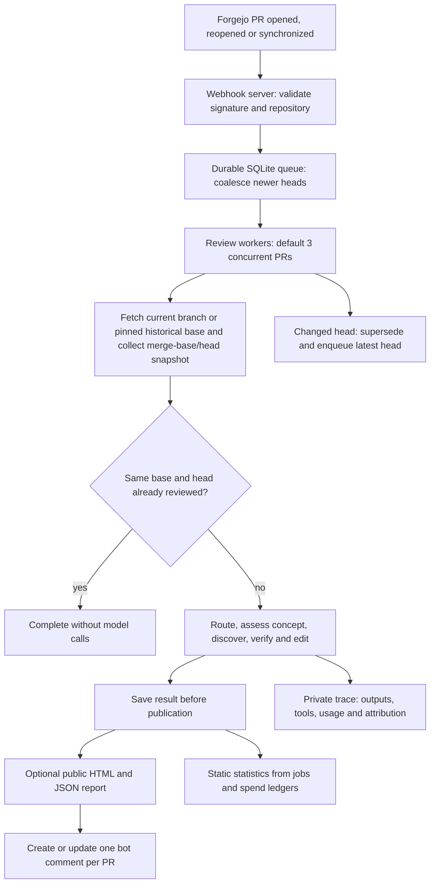

# ralph-service

`packages.<system>.ralph-service` provides the Forgejo webhook service and the
consumers of the [local Ralph review engine](../ralph/README.md). It depends on
the exact core package and imports its `run_review` function directly.

The package installs:

- `ralph-service`, the webhook receiver, queue workers and explicit state converter.
- `ralph-evaluate`, frozen capture/replay, spending inspection and offline summaries.
- `ralph-followup`, background assessment of previously published findings.

The `ralph` command now performs a local review and accepts no service flags.
Change explicit service package overrides to `packages.<system>.ralph-service`
and manual daemon or migration commands to `ralph-service`. The NixOS module,
`services.ralph` options, systemd unit names and existing state paths keep their
names. See the [module guide](../../modules/ralph/README.md) and
[evaluation guide](../../modules/ralph/evaluation.md).

Core imports and defaults live under the core package's `libexec/ralph`.
Companion code and launchers live under `libexec/ralph-service`; wrappers add the
core Python root without copying its source. Core has no companion dependency.

## Service and review lifecycle

Only one attempt runs per PR. Fetch and snapshot preparation share a Git lock;
model calls run outside it. Each attempt pins its Git objects with separate refs.
Head checks prevent stale reviews from being published. Publication retries reuse
saved results rather than paying for another review. Transient transport failures
have bounded job retries. Oversized inputs use a changed-file manifest and diff
tools; if the PR prelude and manifest still exceed 200,000 bytes, review is skipped.

Sources: [service.py](ralph_service/service.py),
[jobs.py](ralph_service/jobs.py), [repository.py](ralph_service/repository.py).

The HTTP listener also serves per-PR PNG status dots at
`/assets/<owner>/<repo>/<pr>.png`. They are Bitcoin orange (`#f7931a`) when the
latest queued generation has published findings or a conceptual concern,
including feedback from partial reviews. All other results are grey. Neither
colour indicates approval or a pass/fail verdict. Status comes from the existing
job store without model or Forgejo API calls. See the module documentation for
proxy setup.

## Prompts and follow-up

Main review prompts resolve inside the core package unless explicitly overridden.
Custom main-review model maps must remove `addressed_findings`; custom main-review
audit directories no longer require `addressed_findings.md`. The follow-up command
loads its bundled `audits/addressed_findings.md` and existing default model
independently. Use `ralph-followup --prompt-file FILE --model MODEL` to override
those settings. It never loads the main-review prompt or complete model map.

## State and upgrades

Keep `jobs.sqlite3`, both review spend databases, private traces, the shared Git
object store and retained refs, public reports, and all of `followup/`.
In particular, preserve follow-up initialization metadata, `assessments.sqlite3`,
its spend database and checkout. The package split adds no state migration or
second queue. The existing explicit pre-engine converter remains available.

Unfinished jobs use the currently configured engine when claimed, including
retries and restart recovery. Saved results retain their original identity and
retry publication without running the engine again.

Switch the companion package, its core dependency, module commands and custom
prompt/model configuration together. Before a deployment, stop timers and
services and take SQLite-consistent backups, retaining refs and reports too.
Hydrate the shared Git store before starting local-only snapshot reads. Start
one companion against the existing state and resume timers after startup succeeds.
No deployment is performed by building these packages. A package rollback does
not undo published comments or recorded model spending.
