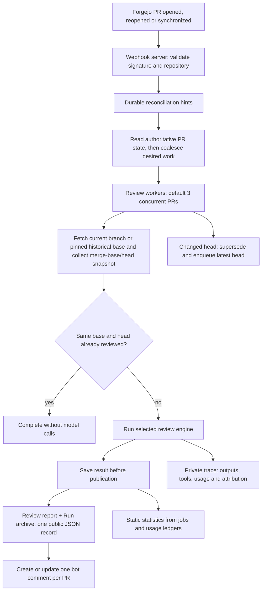

# ralph-service

`packages.<system>.ralph-service` provides the Forgejo webhook service and the
consumers of the [local Ralph review engine](../ralph/README.md). It depends on
the exact core package and imports its `run_review` function directly.

The package installs:

- `ralph-service`, the webhook receiver, job scheduler and explicit state converter.
- `ralph-job`, the single-attempt runner.
- `ralph-evaluate`, frozen capture/replay, usage inspection and offline summaries.
- `ralph-followup`, background assessment of previously published findings.
- `ralph-telegram`, independent Telegram publication, monitoring and channel commands.
- `ralph-feedback`, local maintainer triage of anonymous finding feedback.

The `ralph` command performs a local review and accepts no service flags.
The service uses one repository registry and queue, with independent systemd
review jobs. Configure NixOS under `services.ralph.repositories.<id>`; the module
generates the registry.
Manual commands use the same JSON file:

```sh
ralph-service --state-dir /path/to/state --repositories /path/to/repositories.json \
  --openai-key-file /run/secrets/proxy-key \
  --report-dir /path/to/public-reports --report-base-url https://reviews.example.org/report \
  --archive-base-url https://reviews.example.org/traces
```

The registry is an object keyed by stable IDs such as `core` and `gui`. Each
entry contains `origin`, `repository`, `forgejo_api`, `repository_url`,
`bot_login`, `webhook_secret_file` and `forgejo_token_file`. Credentials are
runtime file paths, never secret contents. `engine_config` holds prompt/model
settings; `strategy` selects `core` or `gui` independently of default/high compute
profiles. `max_workers` caps that repository within the shared `--workers` limit.

Set `core.github_publication` to `"off"`. GUI can set
`github_repository` to `bitcoin-core/gui-qml`, `github_token_file` to its runtime
credential path, and `github_publication` to `"full"`. Only that repository then
publishes full review summaries upstream. Each repository independently accepts
`"off"`, `"major-only"` or `"full"`; the default is `"off"`.

GUI alone sets `submodules` to
`{"bitcoin": "https://github.com/bitcoin/bitcoin"}` and `experiment_shell` to its
Qt environment launcher. Other repositories default to no submodules. Preparation
fetches the configured trusted remote and uses each GUI revision's exact pin;
PR-controlled submodule URLs are not followed. Forgejo mirror sync needs no
submodule update command.

See the [module guide](../../modules/ralph/README.md) and
[evaluation guide](../../modules/ralph/evaluation.md).
For reports, statistics recovery and forced reviews, see
[service operations](operations.md).

Core imports and defaults live under the core package's `libexec/ralph`.
Companion code and launchers live under `libexec/ralph-service`; wrappers add the
core Python root without copying its source. Core has no companion dependency.

## Independent job operations

Use the coordinator's configured `--state-dir` and `--repositories` arguments
with `ralph-service --list-job-units` to list active attempt IDs and unit names.
`ralph-service --cancel-job ID` invalidates that attempt and requests its unit
stop; its concurrency slot remains occupied until exit is confirmed. Run these
commands as the service account. `systemctl restart ralph.service` replaces only
the coordinator and leaves review units running.

Each attempt uses a private manifest and GC roots under `STATE_DIR/attempts`.
The manifest pins its executable and non-secret configuration; credentials are
loaded from their configured files. Do not edit manifests for running jobs.
The scheduler reconciles stopped attempts and removes their roots. Temporary
systemd failures pause recovery rather than invalidating live reviews.

Before schema-breaking upgrades or incompatible rollbacks, stop admission and
drain or cancel all independent jobs. Stopping the coordinator alone does not
stop reviews. Do not restore old queue state over published results. Ordinary
compatible package updates can overlap; a killed worker or reboot can lose
unfinished inference, since reviews do not checkpoint model execution.

## Service and review lifecycle



Only one attempt runs per repository and PR. Each repository has its own checkout;
fetch and snapshot preparation share that checkout's Git lock;
model calls run outside it. Each attempt pins its Git objects with separate refs.
PR target, head and local generation checks guard publication. Webhooks and
stale-head refreshes record durable hints; the coordinator resolves current PR
state before advancing the desired generation. Reconciliation continues while
review workers are busy. Same-head metadata changes do not automatically request
another paid review. Publication retries reuse saved results without another
model run. Transient transport failures have bounded job retries. Oversized inputs use a changed-file manifest and diff
tools; if the PR prelude and manifest still exceed 200,000 bytes, review is skipped.

Review outcome and delivery status are separate. A failed verifier marks the
review as failed in its saved result, public report, logs and statistics. In full
GitHub mode the service updates an existing comment with an attempt status; in
other modes it publishes the Forgejo review and history. It then completes the
queue job so publication retries do not run the models again. A failed review
cannot create, update or delete the upstream GitHub major-findings comment.
Public stage diagnostics include the bounded, redacted provider error message
and HTTP status, without response bodies or headers.

Sources: [service.py](ralph_service/service.py),
[jobs.py](ralph_service/jobs.py), [repository.py](ralph_service/repository.py).

The HTTP listener also serves per-PR PNG status dots at
`/assets/<owner>/<repo>/<pr>.png`. They are Bitcoin orange (`#f7931a`) when the
latest queued generation has published findings or a conceptual concern,
including feedback from partial reviews. All other results are grey. Neither
colour indicates approval or a pass/fail verdict. Status comes from the existing
job store without model or Forgejo API calls. See the module documentation for
proxy setup.

## Uncertain publication recovery

Before sending a comment write, Ralph saves its destination, operation and exact
body in `jobs.sqlite3`. Delivery retries reuse those bytes. A timeout or restart
can leave the remote outcome uncertain. Ralph checks bot-owned comments on both
publication destinations and holds further writes for the PR while an earlier
write remains unresolved, including writes from newer review generations.
Duplicate bot markers require operator investigation.

Stop the coordinator, independent jobs, Telegram monitor, stats and follow-up
timers, and any other state writers before repository schema migration. Back up
the full state and public report directories and verify the backup. Explicitly
assign existing state to `core`:

```sh
ralph-service --state-dir /path/to/state --repositories /path/to/repositories.json \
  --migrate-state --legacy-repository core
```

Migration preserves job IDs, saved reviews, exact publication intent and existing
uncertain delivery holds. Startup refuses unmigrated state. Do not run an older
binary against the upgraded database. Restoring a backup also loses work accepted
since that snapshot and cannot undo remote writes; reconcile intervening work
before restarting. Check record counts and historical report access before
resuming services. Never clear an uncertain delivery hold as part of migration.

Listing holds is read-only, covers all repositories and works while the
coordinator runs. Stop the coordinator before releasing a hold: release acquires
its state-directory lock and requires an explicit repository ID. Neither command
needs provider credentials:

```sh
ralph-service --state-dir /path/to/state --repositories /path/to/repositories.json \
  --list-held-deliveries
ralph-service --state-dir /path/to/state --repositories /path/to/repositories.json \
  --repository-id gui --release-delivery 123 --confirm-no-pending-write
```

Release only after establishing that outstanding writes can no longer arrive.
An absent comment alone does not establish this. Release permits delivery retry
with the saved bytes and can reset the latest saved job's exhausted retry budget;
it does not rerun analysis. Local model cancellation closes the connection but
cannot establish that remote inference or billing stopped.

## Agents, comment formatting and follow-up

See [Contributing](../ralph/CONTRIBUTING.md) for main-review prompt, model and
template changes, and [comment formatting](../ralph/final_comment/README.md)
for public review layout. The service uses bundled agents unless a repository
sets `engine_config.agents_dir` in its registry or
`services.ralph.repositories.<id>.agentsDir` in NixOS. Frozen replay retains
captured settings unless explicitly overridden.

The follow-up command loads its own `audits/addressed_findings.md` and default
model. Use `ralph-followup --prompt-file FILE --model MODEL` to override those
settings. Main-review agent settings do not affect follow-up.

## State and upgrades

Keep `jobs.sqlite3`, `telegram.sqlite3`, private traces, every repository checkout
and retained refs, public reports, and all of `followup/`. Back up the complete
state root, including `repos/`, and the complete public report root. Preserve
follow-up initialization metadata, `assessments.sqlite3`, its checkout and its usage ledger.

New requests are recorded in fresh `usage.sqlite3` and `followup/usage.sqlite3`
databases. Ralph does not read, convert or delete the old spend databases.
There is no price table, monetary admission limit or reservation accounting.
Each request attempt records its outcome and reported usage; missing token or
cache counts remain unknown. The stats page separates these incomplete counts
from reported totals.

Queued and frozen configurations that contain the old budget schema need to be
recreated. No automatic conversion of old usage data or live host deployment
is performed by building these packages.

Pass `--repositories /path/to/repositories.json` to `ralph-evaluate stats` and
`python -m ralph_service.backfill` to attach configured repository names and URLs.
This option is optional for historical/offline presentation. Backfill remains a
dry run unless `--apply` is supplied. Reports and stats label repository identity
and provide per-repository views; Core's existing report URLs remain valid.

## Reports and usage

The stats command can also take `--proxy-management-url` and
`--proxy-management-key-file` together to collect passive Codex and Claude quota
snapshots through CLIProxyAPI v8. Use a separate management key, not an inference
client key. Only the stats process needs it. Snapshots expose no account identity,
OAuth token or credential path. Quotas include usage outside Ralph, remain
separate by window, and show reset times and collection time. Missing readings
are unavailable, never zero. No inference requests or usage-queue reads are made.
The bundled proxy UI does not need a separate frontend deployment.

See [reports and statistics](operations.md#reports-and-statistics) for report
history, attribution, limits and backfill, and
[cache recovery](operations.md#rebuilding-statistics) after restoring state.

## Package updates

Queued reviews retain their resolved profile and prompt settings across retries
and restarts. Each running attempt pins its package and configuration across
deployments. New attempts use the deployed package; the engine hash is recorded
on claim. Saved results retain their original identity and retry publication without running the engine again.

Jobs get one automatic recovery attempt after a 30-second delay. The persisted
failure counter is shared by transient failures, interrupted workers and saved
configuration refreshes; restarts do not reset it. An incompatible saved current
engine configuration is replaced with the deployed configuration before source
collection or model calls, preserving the requested default/high profile.
Compatible saved settings remain unchanged. Once model execution starts, a
failed review is retained in the private trace rather than rerun automatically.
A saved result can still retry delivery without spending more model tokens.
After the allowance is consumed the job is terminal and requires an explicit
rerun. Partial or invalid model results do not trigger a fresh review. This
whole-job policy is separate from bounded retries of individual API requests.

Switch the companion package, its core dependency, module commands and custom
prompt/model configuration together. Before a deployment, stop timers and
services and take SQLite-consistent backups, retaining refs and reports too.
Hydrate each repository's Git store before starting local-only snapshot reads. Start
one companion against the existing state and resume timers after startup succeeds.
No deployment is performed by building these packages. A package rollback does
not undo published comments or recorded model requests.

## GitHub publication

Repository registry fields `github_repository` and `github_token_file` enable
authenticated upstream metadata reads independently of posting.
`github_publication = "major-only"` maintains one upstream GitHub comment with
`critical` and `major` findings and a public report link, alongside the native
Forgejo review. `"full"` publishes only on GitHub, including other finding
severities, verified design assessments, coverage notices and the
no-actionable-issues message when appropriate. Source
links point to GitHub. Both modes use a six-finding limit; the Review report retains
the rest. Full mode leaves existing native Forgejo comments untouched and does
not fall back to Forgejo if GitHub publication fails. Posting requires public
report configuration and credentials.
Later reviews update the same comment. In major-only mode, a complete review can
delete it when no Critical or Major findings remain; incomplete reviews cannot
delete the comment. Failed or skipped reviews leave the major-only comment alone.
In full mode, failed, skipped, unavailable-export and unverified attempts never
create a comment; if one exists they update it with status, attempted head, a fixed safe reason, the attempt
report, and the previous completed review when available. No findings appear in
these status comments. Terminal acquisition failures use the same saved-result
publication path; transient errors retry before publishing failure. Publication
transport errors never replace a completed review with a failure status.
`"off"` leaves existing comments untouched. No database migration is needed;
existing exact delivery intents are preserved until reconciled. Upstream PR
numbers must match the mirror. Writes require an open upstream PR matching the
reviewed head and base branch. Metadata edits do not block publication. GitHub
credentials are separate from Forgejo credentials. Review tools may use them
for discussion reads, so do not grant access to private repositories.

Comments neutralize `@` mentions. Publication requires source-verifier and judge
approval. Changing modes does not request a new review of an unchanged head or
replace an uncertain write. A saved full-comment intent can still be delivered
after switching to `"major-only"`; `"off"` also prevents saved intents from
being dispatched.

## Telegram

Run `ralph-telegram` separately from the review daemon with `--state-dir`,
`--report-dir`, `--report-base-url`, `--archive-base-url`,
`--repositories /path/to/repositories.json`,
`--telegram-token-file /run/secrets/telegram-token` and
`--telegram-chat-id @channel`. Use a numeric channel ID for a private channel.
The monitor reads review state and recorded usage, publishes completed reviews, sends
grouped terminal failure alerts, and delivers a daily digest at 21:00 UTC.
It continues running when the review daemon stops.

Each review notification contains the PR title, current finding counts by severity,
and links to the PR and Review report. Review bodies are never included. Long
titles are shortened to fit Telegram's 4,096 UTF-16 code unit limit while
preserving the counts and links. A new exported finding with severity exactly
`major` adds `🚨 Major finding`.

Post `/status` in the configured channel for service states, queue and result
totals, usage and subscription quotas. `/help` lists commands. `/review gui 1049`
requests a fresh default-profile review; `/high gui 1049` selects high.
Commands accept stable repository IDs, and shorthand such as `gui1049` or
`bitcoin36688`; ambiguous selectors are rejected. The PR must be open.
An explicit `/review` replaces a pending high request with the default profile;
ordinary webhooks and head refreshes preserve pending high reviews. Commands
cannot restart services.

Commands are channel-only. All channel administrators may issue them. Anonymous
posts rely on Telegram's administrator posting permissions; identified senders
must be current administrators. The monitor verifies bot posting permission
instead of trusting displayed signatures. Direct messages are ignored.

Requests are saved with the Telegram update offset and reply in
`telegram.sqlite3`. The daemon consumes them and records request IDs with the
job, so restarts cannot duplicate a command. The monitor accepts commands while
the daemon is stopped; a second reply confirms queueing or explains rejection.
Preserve this database with the rest of the state.

The monitor checks for completed reviews and terminal failures every 30 seconds,
grouping new failures into one alert. On first enable, existing jobs form a
baseline and are not posted. The 21:00 UTC digest covers the preceding day's
observed completions and failures, queue depth and recorded usage. After
downtime, only the latest completed window is sent. Missing ledgers and unknown
usage remain explicit.

Command replies take priority over background posts, which send one message per
check. All messages honor Telegram's retry delay. A crash after Telegram accepts
a message but before Ralph records delivery can cause a duplicate.

Normal webhook reviews use the default profile. Set the repository's `engine_config.profile` to
`"high"` to select high for ordinary reviews too. Custom engine modules do not
support `/high`.

Use a bot token from `@BotFather`, grant the bot channel administrator
permission to post, and keep its token in a runtime secret file readable by
the service user. The monitor polls Telegram; no webhook or inbound port is
needed. See the
[module guide](../../modules/ralph/README.md#telegram-publishing-and-monitoring)
for NixOS setup and delivery behavior.

## Backport reviews

Backport PRs receive the core's fidelity and release-branch review. The service
collects labels, title/body and the target branch before checking for a reusable
result. It resolves upstream PR commit lists and original objects, including
abbreviated `Rebased-From` trailers, then pins the acquired history for the review.
Unavailable or ambiguous provenance appears in the report as a limitation.

Reuse includes a fingerprint of review metadata and backport evidence alongside
the engine identity and base/head. Metadata is checked again during review and
before publication. Publication retries reuse the saved result when its reviewed
context remains current. Installing the feature does not enqueue historical PRs.

The report includes the verified backport assessment separately from inline code
findings. Missing whole commits can therefore be reported without fabricating a
source-line location. See [core behavior](../ralph/docs/engine.md#backport-reviews).

Label/body edits alone do not enqueue reviews. Use the existing explicit review
request to re-review an unchanged head after editing its backport scope.

Frozen cases retain backport evidence and available upstream objects. Replay
rejects changed evidence or missing source pins before any model request. See
the [evaluation guide](../../modules/ralph/evaluation.md) for capture compatibility.

## PR-local author feedback

Before a re-review, the service gathers earlier completed findings for that PR
and carries their saved review memory forward. New results record repository/PR
scope explicitly; legacy results use the service's dedicated repository database.
No history is shared between PRs. Comment edits alone do not enqueue new reviews.

For repositories configured with `github_repository`, author identity comes from
the upstream GitHub PR's numeric user ID. The service captures that author's issue
comments, inline replies and review bodies from GitHub. Standalone replies on the
Forgejo mirror are not included in this mode. Native Forgejo repositories use
Forgejo numeric user IDs; imported author names alone are insufficient. Reads are
bounded and record omissions. First reviews perform no feedback discussion reads.

Author comments are untrusted text. Their exact captured bodies, IDs, URLs,
timestamps and hashes accompany the previous findings and a bounded revision
diff. “Addressing elsewhere” cannot erase an issue: the core verifier must check
the code, and unresolved history remains in reports and status badges even when
there are no new findings. A collapsed entry is still unresolved. A historical
concern must pass the current verifier and publication judge before appearing
as a finding again. Its technical `still_present` status alone is insufficient;
the report renderer never promotes memory entries into findings.

Same-head reuse checks revision and review metadata before feedback acquisition,
so new replies cannot trigger duplicate model runs. The packet fingerprint is
saved separately with the result. Publication retries use the
saved result and frozen packet without another model run. Frozen
captures retain the same evidence. Historical captures exclude older results
without a trustworthy completion timestamp; ordinary captures retain legacy
history. Feedback acquisition failures retain prior findings for reconciliation
without treating unavailable replies as author acceptance or rejection.

### Review health

`stats/health/` shows operational health separately from review outcomes. The
Telegram monitor reads the same cached stats summary and alerts when three of
the last five eligible stage runs within 24 hours have failed, exhausted their
output budget, or retained invalid coverage evidence after repair. Runs are
grouped by repository, stage, model and saved engine/configuration/budget hash.
Ordinary partial coverage and merely reaching a tool cap do not trigger alerts.

Each incident produces one alert, persisted across monitor restarts. Three
fresh consecutive successful runs produce a recovery notification. A missing
or more than ten-minute-old stats snapshot cannot start or recover incidents.
The summary uses saved terminal results and dates them from usage-ledger stage
completion timestamps. It excludes live work, cancelled/stale reviews,
undated results and overwritten retry attempts; it does not assess whether
review conclusions are correct.
