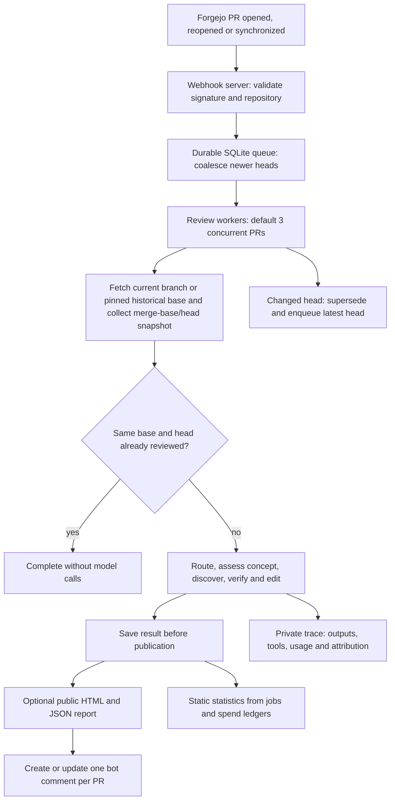

# ralph-service

`packages.<system>.ralph-service` provides the Forgejo webhook service and the
consumers of the [local Ralph review engine](../ralph/README.md). It depends on
the exact core package and imports its `run_review` function directly.

The package installs:

- `ralph-service`, the webhook receiver, queue workers and explicit state converter.
- `ralph-evaluate`, frozen capture/replay, spending inspection and offline summaries.
- `ralph-followup`, background assessment of previously published findings.
- `ralph-telegram`, independent Telegram publication, monitoring and channel commands.

The `ralph` command now performs a local review and accepts no service flags.
Change explicit service package overrides to `packages.<system>.ralph-service`
and manual daemon or migration commands to `ralph-service`. The NixOS module,
`services.ralph` options, systemd unit names and existing state paths keep their
names. See the [module guide](../../modules/ralph/README.md) and
[evaluation guide](../../modules/ralph/evaluation.md).

Core imports and defaults live under the core package's `libexec/ralph`.
Companion code and launchers live under `libexec/ralph-service`; wrappers add the
core Python root without copying its source. Core has no companion dependency.

## Service and review lifecycle

Only one attempt runs per PR. Fetch and snapshot preparation share a Git lock;
model calls run outside it. Each attempt pins its Git objects with separate refs.
Head checks prevent stale reviews from being published. Publication retries reuse
saved results rather than paying for another review. Transient transport failures
have bounded job retries. Oversized inputs use a changed-file manifest and diff
tools; if the PR prelude and manifest still exceed 200,000 bytes, review is skipped.

Sources: [service.py](ralph_service/service.py),
[jobs.py](ralph_service/jobs.py), [repository.py](ralph_service/repository.py).

The HTTP listener also serves per-PR PNG status dots at
`/assets/<owner>/<repo>/<pr>.png`. They are Bitcoin orange (`#f7931a`) when the
latest queued generation has published findings or a conceptual concern,
including feedback from partial reviews. All other results are grey. Neither
colour indicates approval or a pass/fail verdict. Status comes from the existing
job store without model or Forgejo API calls. See the module documentation for
proxy setup.

## Prompts and follow-up

Main review prompts resolve inside the core package unless explicitly overridden.
Custom main-review model maps must remove `addressed_findings`; custom main-review
audit directories no longer require `addressed_findings.md`. The follow-up command
loads its bundled `audits/addressed_findings.md` and existing default model
independently. Use `ralph-followup --prompt-file FILE --model MODEL` to override
those settings. It never loads the main-review prompt or complete model map.

## State and upgrades

Keep `jobs.sqlite3`, both review spend databases, private traces, the shared Git
object store and retained refs, public reports, and all of `followup/`.
In particular, preserve follow-up initialization metadata, `assessments.sqlite3`,
its spend database and checkout. The package split adds no state migration or
second queue. The existing explicit pre-engine converter remains available.

Daily and weekly cost tracking requires the request-timestamp migration in
`ralph-service --state-dir DIR --migrate-state`. The NixOS module runs it before
starting the service. It backs up and upgrades both review spend databases and
`followup/spend.sqlite3`, skipping missing or already upgraded databases.
Backups use the `.pre-timestamps.bak` suffix. Historical costs retain their
accounting month and an unknown timestamp; the Usage page includes them in
monthly totals and identifies their absence from daily and weekly charts.
Stats reads never modify private state.

Queued reviews retain their resolved profile and prompt settings across retries
and restarts. The running engine code may update after a deployment; its hash
is recorded when the worker claims the review. Saved results retain their
original identity and retry publication without running the engine again.
Existing unfinished reviews migrate once into the default profile, preserving
their configured models.

Switch the companion package, its core dependency, module commands and custom
prompt/model configuration together. Before a deployment, stop timers and
services and take SQLite-consistent backups, retaining refs and reports too.
Hydrate the shared Git store before starting local-only snapshot reads. Start
one companion against the existing state and resume timers after startup succeeds.
No deployment is performed by building these packages. A package rollback does
not undo published comments or recorded model spending.

Optional `--github-repository owner/repo` and `--github-token-file /run/secrets/token`
maintain one upstream GitHub comment with exactly `major` findings and a public
report link. Both report options are required. Later completed reviews update
or delete the comment when major findings change or disappear. Skipped reviews
and missing findings exports preserve it. Upstream PR numbers must match the
mirror, and the upstream must be open at the reviewed head before a write.
GitHub credentials are separate from Forgejo credentials and model tools.

Run `ralph-telegram` separately from the review daemon with `--state-dir`,
`--report-dir`, `--report-base-url`, `--repository-url`,
`--telegram-token-file /run/secrets/telegram-token` and
`--telegram-chat-id @channel`. Use a numeric channel ID for a private channel.
The monitor reads review state and costs, publishes completed reviews, sends
grouped terminal failure alerts, and delivers a daily digest at 21:00 UTC.
It continues running when the review daemon stops.

Each review post contains the PR title and links to the PR and full report.
The full review is included when the complete post fits 4,096 UTF-16 code
units; longer reviews use the title and links only. An exported finding with
severity exactly `major` adds `🚨 Major finding` in either form.

Post `/status` in the configured channel to see service states, queue and
result totals, and estimated costs. `/high <PR number>` requests a fresh review
of an open PR in the configured repository using the high profile. It increases
the harder core review stages and multiplies the OpenAI review allowance by
five; the monthly cap and PPQ allowance stay unchanged. `/help` lists the
commands. Commands are channel-only. All channel administrators may issue commands.
Anonymous posts rely on Telegram's administrator posting permissions;
identified senders must be current administrators. The monitor verifies bot
posting permission instead of trusting displayed signatures. Direct messages
are ignored. Replies are sent as soon as the summary is ready and take
priority over background posts, while honoring Telegram's retry delay.

High requests are saved with the Telegram update offset and reply in
`telegram.sqlite3`. The review daemon consumes them and records request IDs
transactionally with the job, so a restart cannot duplicate a command. Normal
webhooks and head refreshes preserve a pending or running high review. The
monitor can accept commands while the review daemon is stopped. A second
reply confirms queueing or explains why the PR could not be queued.

Normal webhook reviews use the default profile. Set `engineConfig.profile` to
`"high"` to select high for ordinary reviews too. Custom engine modules do not
support `/high`.

Use a bot token from `@BotFather`, grant the bot channel administrator
permission to post, and keep its token in a runtime secret file readable by
the service user. The monitor polls Telegram; no webhook or inbound port is
needed. See the
[module guide](../../modules/ralph/README.md#telegram-publishing-and-monitoring)
for NixOS setup and delivery behavior.
