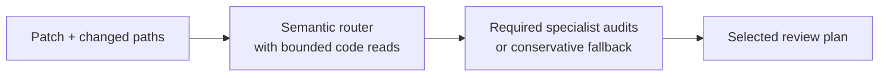
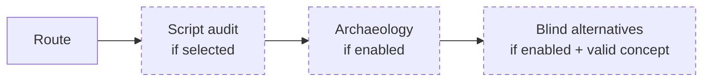
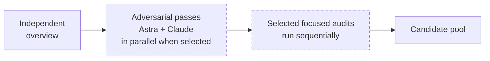
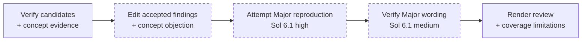
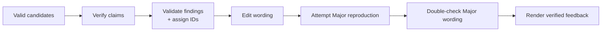

# ralph local review

Ralph loads a selected local review engine. The default `current` engine performs
static reviews of committed Bitcoin Core changes, discovers candidate findings in independent
passes, checks them against repository evidence, and returns verified findings
and a separately verified conceptual assessment. Surviving Major findings can
receive an optional build/test experiment in an isolated disposable workspace. The engine owns its Markdown and structured result; other engines need
not use the stages, diagnostics or exports described below. Operators can load
only trusted engine modules included in the package. Engines own their output
style and engine-specific checks; current-engine tests and diagnostics do not
prescribe another engine's review format.


## Contributing prompts and comment formatting

Start with [Contributing](CONTRIBUTING.md) to edit a prompt, model, reasoning
effort or tool limit. The [agent flow](agents/README.md) explains selection and
verification. Each agent has a `config.toml` and a Markdown prompt. Shared
instructions have their own directory, and per-agent high-profile overrides
stay beside the default settings.

The [final_comment/](final_comment/README.md) directory contains Markdown
templates for comment structure, an offline preview and example reviews. The
[collator prompt](agents/collator/prompt.md) controls the wording of accepted
findings. Public comments show at most six current verified findings, each with
a severity symbol and label, title, source location and one-sentence summary.
Full explanations, alternatives and review history remain in the report and
structured exports. The runtime validates
findings and enforces tool and timeout limits.

From the repository root, using Python with `aiohttp` installed:

```sh
python3 pkgs/ralph/review.py check-agents
python3 pkgs/ralph/final_comment/preview.py > /tmp/ralph-comment.md
python3 -m unittest discover -s pkgs/ralph -p 'test_*.py'
```

These checks and previews run without credentials or model requests. A prompt
or template PR can stay entirely in those directories. Include an example of
the intended behavior or preview when useful.

`packages.<system>.ralph` installs only the `ralph` review command. The
[companion package](../ralph-service/README.md) supplies the webhook service,
frozen evaluator, reports, statistics and follow-up scheduler.

```sh
ralph review topic /path/to/repo \
  --base refs/remotes/origin/master \
  --openai-key-file /path/to/openai-key \
  --output /tmp/topic-review.json

ralph review 'HEAD^..HEAD' /path/to/repo \
  --openai-key-file /path/to/openai-key
```

Branch mode requires an explicit `--base` and compares the unique merge base
with the target. An explicit `BASE..HEAD` range compares those exact committed
trees, including diverged endpoints. Both endpoints are required. Working-tree
and index changes, root commits, and triple-dot shorthand are unsupported.
Ralph resolves revisions once, pins their objects until the run finishes, and
reads blobs without checkout or index changes. It never fetches Git objects or
calls a forge. Missing objects or history fail before model requests.

Stdout contains review Markdown. Progress and errors go to stderr. `--output`
writes a private versioned JSON artifact containing engine identity, base/head,
merge base, actual diff base, native data, supported exports, usage and status.
Use `--help` for tool limits and trusted local engine options.

The current engine sends Codex and Claude requests through the same
OpenAI-compatible endpoint and access key. Configure CLIProxyAPI with both
accounts and put its URL in an engine configuration:

```json
{"openai_api_base": "http://127.0.0.1:8317/v1"}
```

Pass this file with `--engine-config` and use the proxy's access-key file with
`--openai-key-file`. Ralph still supplies the prompts and executes tools; no
coding CLI is launched. The URL is recorded in engine identity, so keep
credentials out of it. Review stages and audits use this URL without falling
back to the OpenAI endpoint on failure. Claude strict JSON schemas become
prompt guidance at the proxy; Ralph parses and validates returned results.

Ralph records request attempts and provider-reported token usage without pricing
it or using monetary admission limits. Missing usage remains unknown.
CLIProxyAPI removes `max_output_tokens` before forwarding Codex requests, so the
requested output allowance is not an enforced cap on that path. Ralph omits
`max_tool_calls` from outgoing requests because Codex rejects it, and enforces
its own tool limits. Hosted search counts are recorded even when a response
exceeds the configured allowance. The proxy/provider enforces subscription
limits.

Model requests retry HTTP 429, 5xx and transient transport failures up to three
total attempts, preserving the current conversation. Backoff is one then two
seconds; a numeric `Retry-After` can extend either wait up to ten seconds.
Other HTTP errors, including rejected parameters, fail immediately. Every
attempt checks cancellation and records a separate usage attempt. Missing
usage after a timeout or server error is not estimated.
Failed attempts remain in diagnostics even when a retry succeeds. HTTP failures
retain the status and a bounded, redacted provider message, without the raw
error response or request body.

Archaeology defaults off for local changes. `--context FILE` can supply versioned
review context and optional source metadata, for example:

```json
{
  "schema_version": 1,
  "title": "Review title",
  "rationale": "Problem and intended change",
  "source": {
    "kind": "pull_request",
    "url": "https://git.example.org/owner/repo/pulls/123",
    "number": 123
  }
}
```

The `source` field is optional. A PR source records its actual URL and number. `--research-evidence FILE` supplies captured discussion evidence;
core never retrieves discussions itself. `--archaeology auto|on|off` resolves to
a boolean before engine identity is recorded. Forced enabling requires usable
PR context and discussion evidence. Disabled archaeology and blind alternatives
make no model requests and do not reduce ordinary code coverage. Hosted web
permission is separate from discussion access.

Follow-up prompt and model settings belong to the companion and are configured
separately. Main review customizations use a complete `--agents-dir` tree or
individual `stages` overrides in the engine configuration.

## Engine boundary

The CLI or companion supplies a review case and bounded runtime services to the selected
engine. It stores the engine-produced Markdown, native structured data,
optional consumer exports, common run metrics and the engine's code/config
identity. Native engine data remains private. Consumers use declared exports;
an omitted export is unavailable, while an empty list is a supported empty
result. They do not derive findings from rendered Markdown. This keeps the
current pipeline's diagnostics available to its own reports without making
those stages a requirement for another engine.

The current engine accepts resolved prompts or prompt file/model settings,
routing, archaeology and blind-alternative controls. Its resolved settings are
fixed for frozen evaluations. Core and engine code determine engine identity;
companion-only website and webhook changes do not change it.

An engine module implements two functions:

```python
configure(config_dict) -> normalized_config_dict
run(case, runtime, normalized_config_dict) -> engine.Output
```

`engine.load(name, config)` calls `configure` and returns an object whose
`run(case, runtime)` checks and returns an `Output`. The output carries
`content` (engine-produced Markdown), `data` (private native data), and
`exports` (supported consumer data), and `status` (`completed` or `failed`,
defaulting to `completed`); generic validation checks the envelope,
not an engine's native schema. Native data stays private by default. The current
report adapter explicitly selects diagnostics only for the declared `current`
engine and native schema version 2, through
[`trace.current_diagnostics`](ralph/trace.py).
Older results retain their saved review text and declared exports; the current
diagnostic adapter does not interpret their native stage details.

Inside the current engine, [pipeline.py](ralph/pipeline.py) keeps scheduling,
stage requests, verification and editing in separate functions. It returns a
`ReviewResult` containing Markdown, final finding records and the verified
concept concern. [current_engine.py](ralph/current_engine.py) builds exports
from that result; diagnostic dictionaries retain stage details and partial
attempts. Finding records preserve original and presented wording, and exports
keep verification order even if the editor reorders the prose.

The diagrams and implementation details below describe the `current` engine.

These diagrams describe the checked-in defaults. [agents/](agents/README.md)
defines each review profile. Callers can use `--agents-dir` or override individual
stage settings through `--engine-config`.
The [NixOS module documentation](../../modules/ralph/README.md)
covers deployment and options. Mermaid diagrams render in supporting Markdown
viewers; their source remains readable in a plain text editor.

## Audit selection

Enabled routing uses Sol 6.1 at high reasoning to classify changed behavior and
select adversarial domains. It receives the complete changed-path manifest and
bounded patch, with up to eight read-only calls to inspect diffs, base/head code
and callers. Calls are optional when the supplied evidence establishes the route.
The router uses its configured standard-tier call allowance before a tier exists.



| Selection or escalation | Result |
| --- | --- |
| Enabled routing | Use the semantic tier and profiles; add mandatory specialist audits from paths. |
| Explicit full mode | Select every audit and profile, including script. |
| Shadow mode | Record the routing proposal, then select every audit and profile, including script. This also applies after routing fallback. |
| Invalid or failed routing, material missing context, or oversized patch | Use the sensitive general plan with all profiles, excluding script. Full and shadow modes still include script. Provider or stage failures remain explicit. |
| Overview requests sensitive review from a lower tier | Add all general audits and profiles, excluding script. |
| A focused audit requests sensitive review from a lower tier | Add adversarial, state and concurrency; keep selected profiles, or use all profiles if none were selected. |

Paths do not impose a tier or add adversarial profiles. Comments in a consensus
header can be routine; wallet logging and demonstrably mechanical refactors can
be standard. Sensitive decisions must identify a changed security boundary or
invariant. Downgrading a critical-subsystem refactor requires evidence that the
relevant behavior is preserved. Unresolved material questions request conservative
coverage. Selecting the semantic script specialist still requires sensitive review.

A sensitive tier always adds adversarial review, even when no domain profile is
selected. Domain profiles extend that prompt; they are not separate model calls.
An explicit model request for an adversarial profile requires sensitive coverage,
so a contradictory lower-tier proposal cannot silently skip that request.
These profiles are distinct from the `default` and `high` review settings profiles.

| Changed paths, excluding tests where stated | Mandatory specialist coverage |
| --- | --- |
| Tests or production code | tests audit |
| Any non-documentation path, including tests and recognized build files | dead_code audit |
| Production code, excluding docs, tests and recognized build paths | design audit |
| Synchronization, scheduler, queues, validation callbacks, thread utilities | concurrency audit |
| Databases, indexes, wallet storage, chainstate and block storage | state audit |
| RPC, CLI, HTTP, REST, initialization and argument handling | public_contract audit |
| Recognized build paths, including CMake, depends, Guix, CI and Cargo/flake locks | build audit |

These are summaries of the regex rules in [routing.py](ralph/routing.py).
Documentation files are excluded from directory-based coverage; `CMakeLists.txt`
and `requirements.txt` are configuration despite their suffix. CI scripts under
`ci/test/` retain both build and test audits. The router can add relevant audits.
Empty audit and profile lists are valid when no coverage applies. Routine does
not mean no review.

## Script and transaction-policy specialist

The `script` audit is selected by the router only for substantive changes
in script execution or flags, signatures and sighash commitments, witness or
annex rules, spend-type acceptance, or transaction validity and fee-bumping
constraints. Filenames and a sensitive tier do not select it automatically.
Documentation, test-only changes, mechanical refactors, logging, metrics and
unrelated work in validation or policy files skip it. Generic missing context,
routing failures and overview escalation do not add it. Explicit `full` and
`shadow` modes still request every audit, including `script`.

Its [prompt](agents/script/prompt.md) checks consensus versus policy, complete base/head
functions and relevant spend-type combinations. It distinguishes signed
participants from inputs such as P2A anchors, and tests the premise of a new
transaction-wide rule against existing exceptions. The PR #36466 all-input annex
condition is a motivating case, rather than a reason to run this stage on every
transaction-related patch.

The default is `gpt-6.1-sol`, high reasoning, 25,000 generated tokens per response
including reasoning, and 48 total tool calls. These are initial settings, not a
measured optimum. The specialist sees original PR evidence and repository code,
not other findings or review discussion. Code tools inspect base/head, diffs,
callers and tests; history tools settle specific contracts. It must inspect code
before finishing and prioritize material functions over reporting them unread.

When selected it runs before any enabled concept research and other discovery.
Incomplete stages remain explicit. Candidates go through the existing
verifier, and named discovery gaps are passed to the verifier for targeted
inspection. Remaining gaps stay visible in coverage. Stage stats include
selection, execution, coverage, usage and sole/shared accepted findings.
Custom agent directories must include the `script` agent.

## Stages, models and evidence

Read each row from left to right, then continue with the next row. Arrows show
execution order, not shared findings. Dashed boxes run only when selected or
enabled. Model names and limits are listed in the table below.

**1. Select coverage and gather optional context**



**2. Discover independent candidates**



Focused audit order: concurrency, state, public_contract, build, tests,
dead_code, design. Discovery can escalate coverage and add pending audits.
Claude adversarial review requires `claude-opus-5-5` on the configured proxy.
A failed Claude pass is reported as incomplete coverage.

**3. Verify, edit, double-check Majors and render**



Editing runs only when findings or a concept objection survive verification.
An independently verified optional alternative goes straight to rendering.
Only findings with severity exactly `major` go through the second verifier.
This includes Major design findings. Other severities skip it. Sol checks the
final edited title and body, with independent reads of the pinned base/head,
before either the mirror review or GitHub export can publish them. It returns
verdicts only and cannot rewrite, add, merge, or downgrade findings.

The write-verifier attempts experiments before that final check. It can report
`reproduced`, `refuted`, or `inconclusive`, with references to runner-recorded
commands. None of these outcomes alone decides publication. The final Major
verifier assesses the evidence and exact wording. An impractical reproduction,
missing environment, timeout, or writer failure still permits publication based
on sufficient source evidence. A passing test alone does not refute a finding.

Experiments use the pinned Bix development environment supplied by the Nix
package. Each `experiment_run` starts with pristine head or comparison-base
source in a bounded temporary filesystem. Include every edit, build and test in
one script; a later call does not retain earlier edits or build products. The
runner records the revision, command, exit status, bounded output, and source
patch including new tests. Commands execute without host credentials, service
state or outbound network; functional tests have private loopback. Failure to
start the sandbox leaves the finding eligible for static verification.

The NixOS module provisions a delegated cgroup for experiments. Each experiment
has an 8 GiB total memory limit including temporary files, no swap, 128 tasks,
and two CPUs of aggregate execution time per wall-clock interval. Experiments
share a 30-minute stage deadline with model requests, and service workers
serialize experiments. Commands should build under `/tmp/build` so recorded
source patches are not filled with compiler output.

For a standalone CLI run, start a delegated user service and identify its
subtree before invoking Ralph:

```sh
systemd-run --user --collect --wait --pipe \
  -p 'Delegate=cpu memory pids' -p DelegateSubgroup=controller \
  bash -c '
    group=$(sed -n "s/^0:://p" /proc/self/cgroup)
    export RALPH_WRITE_VERIFIER_CGROUP="/sys/fs/cgroup${group%/controller}"
    exec ralph "$@"
  ' ralph review topic /path/to/repo --base origin/master \
  --openai-key-file /path/to/openai-key
```

Without a delegated subtree or the packaged experiment environment, execution
is unavailable and the final Major check still considers source evidence.

Skipped audits do not make model calls. All review stages use the configured
OpenAI-compatible endpoint and key. Concept research is advisory. Negative,
failed or incomplete research never skips an independent, adversarial or focused code stage selected
for the review.
Reviewers do not see other discovery passes' candidates. The verifier sees the
pooled candidates, original review input, any archaeology and blind-alternative
candidates, and named inspection gaps from incomplete discovery. Code discovery
does not receive concept research output or current PR discussion.

| Stage | Default model | Reasoning effort | Per-response output token ceiling | Evidence access |
| --- | --- | --- | --- | --- |
| router | gpt-6.1-sol | high | 8,000 | Up to 8 code inspections |
| independent | gpt-6-luna | low | 4,000 | Full tool set |
| script | gpt-6.1-sol | high | 25,000 | Original input; code and base history, no discussion or web tools |
| adversarial | gpt-6-astra | high | 25,000 | Full tool set and selected domain profiles |
| adversarial_claude | claude-opus-5-5 | xhigh | 64,000 | Same tools and profiles, via the configured proxy |
| concurrency | gpt-6-luna | medium | 8,000 | Focused input and code tools |
| dead_code | gpt-6-luna | medium | 8,000 | Original input; base/head code and history, no discussion or web tools |
| public_contract | gpt-6.1-sol | low | 25,000 | Focused input and code tools |
| state, build, tests | gpt-6-luna | low | 4,000 | Focused input and code tools |
| design | gpt-6-luna | xhigh | 25,000 | Focused input, code tools and comparison-base developer notes |
| verifier, all tiers | claude-opus-5-5 | xhigh | 64,000 | Original input, candidates, concept candidate, code and research tools |
| write_verifier, only when Majors survive | gpt-6.1-sol | high | 12,000 | Final Major wording, immutable source tools and isolated experiment commands |
| major_verifier, only when Majors survive | gpt-6.1-sol | medium | 25,000 | Original input and final Major wording; code and base history tools |
| archaeologist | gpt-6-luna | low | 4,000 | Original input, base/head code tools, current discussion and research tools |
| alternatives | Same as archaeologist | low | 4,000 | Neutral problem, goal and baseline; base-only code tools |
| collator | gpt-6-luna | low | 6,000 | Accepted findings and conceptual assessment; no tools |

Model requests use Responses event streams with a 1,800-second deadline per
attempt in both review profiles, including tool calls, final responses and
follow-ups. The deadline includes connecting and reading the response;
heartbeats cannot extend it. Ralph consumes the terminal response, preserving
usage and reasoning, and executes tools only after a completed response.
Ralph still makes at most three attempts per request, so three stalled attempts
can take about 90 minutes.

The initial review input allows 300,000 UTF-8 bytes. Larger patches are replaced
by a changed-file inventory so stages can inspect them with `read_diff`.
File reads return up to 300 lines and 12,000 UTF-8 bytes per call. Published
source evidence retains the smaller excerpt limit described below.

Code tools find paths, read head/base files, read diffs and search code. The full
tool set also reads base history and, when a live discussion reader is supplied,
other PR discussions. Current PR discussion is excluded from code discovery.
In frozen runs, discussion tools are available only to the archaeologist and
verifier. These stages can read current discussion and original upstream review
threads from the supplied evidence. Frozen evaluations replay only
captured research evidence and disable live discussion or web fallback. If a
research call is missing from the frozen manifest, the tool returns an
unavailable-evidence message and the model continues from code and frozen input.

Discovery allows 12 tool calls at routine tier, 24 at standard, and 48 at sensitive.
The script and dead-code specialists allow 48; both adversarial passes and both
verifiers allow 72. History and discussion sublimits are eight each per
tool-enabled stage. Archaeology has twelve total
inspections. Hosted web actions count toward the stage limit. The allowance of
two per response is advisory, so a provider response can exceed it. The early
concept stage never stops later code stages.
Script, dead_code, independent, both adversarial passes and both verifier stages
require a first inspection. Claude uses automatic tool selection because Opus
5.5 rejects forced tool calls; Ralph checks that inspection occurred. At limits,
a final turn uses collected evidence and must preserve uncertainty.

The [dead-code audit](agents/dead_code/prompt.md) runs on production, test, script and
build changes, including deletions and mechanical refactors. Ordinary docs-only
changes skip it unless routing requests it. It checks both new unused code and
existing code orphaned by the PR, following removed references into unchanged
files. Literal base/head searches and caller inspection must account for
indirect uses, supported configurations, external contracts and side effects
before recommending deletion. Findings use the normal suggestion and verifier
flow; no runtime failure is required for a proven safe removal. Its 48-call
limit allows reference tracing even on routine PRs. These settings have not
been tuned against live reviews.
Custom agent directories must include the `dead_code` agent.

Failed discovery becomes a coverage limitation; failed verification publishes
no unverified findings. Failed editing falls back to verified wording.
The Major pass checks findings after any optional write-verifier experiments.
An API failure, invalid response, or missing decision withholds all pending
Majors. Explicit `drop` and `unresolved` verdicts withhold those findings;
non-Majors and concept results remain available. Reasoning effort and token
limits are initial settings, not a measured accuracy guarantee.
Custom agent directories must include the `write_verifier` and `major_verifier`
agents. Saved profiles without the new stage must be recaptured.
The companion GitHub publisher also requires second-verifier provenance for
every Major, including saved publication retries. An unchecked batch is skipped
without posting or deleting a comment.

Public coverage separates code review, historical context, and verification.
Missing advisory history does not reduce code coverage. Expected static-review
scope, such as not running tests, is shown as a scope note rather than missing
evidence. Actual unread paths and failed stages identify their specific reason.
Failed main or Major verification marks the whole run `failed`, while preserving
independently verified findings and the full historical records in the structured
result. The report leads with a failure notice and presents historical findings
as a compact list for follow-up. The public comment carries a brief unresolved-history
notice. The CLI prints the full review and exits with status
1. Historical records do not become newly verified findings when a verifier fails.
Candidate ID bookkeeping errors
withhold the affected decisions, preserve independently valid findings, and
leave unaccounted candidates unresolved.

Sources: [pipeline.py](ralph/pipeline.py),
[model.py](ralph/model.py), [usage.py](ralph/usage.py),
[config.py](ralph/config.py).

## How findings survive or get rejected

The successful path is short. Validation and recovery rules are listed below
so they can be read without following crossing arrows.



| Check or outcome | What survives |
| --- | --- |
| Malformed discovery response | Discard that stage's candidates and record a limitation; keep other stages. |
| Malformed verifier envelope or decision structure | Reject the verifier response; publish no findings from it. |
| Unknown, repeated or omitted candidate IDs | Withhold affected decisions and mark affected or omitted candidates unresolved; retain independently valid findings. |
| Claim is disproved or unsupported | Drop the claim. |
| Decisive evidence is missing, or a finding fails validation | Withhold that finding and record a limitation; retain valid findings. |
| Concept objection is unsupported or invalid | Withhold the objection; retain verified code findings. |
| Editing fails or changes the accepted ID set | Keep all accepted findings with their original verified wording and metadata. |
| Second verification rejects or cannot verify a Major | Withhold it from public findings and exports; retain the decisions in the trace. |
| Second verification fails or has invalid ID accounting | Withhold every pending Major; preserve other severities and concept results. |

The verifier may merge supplied candidates, but cannot introduce new code findings.
Every code decision must cite at least one supplied candidate ID.
It checks conceptual feedback separately from code findings. Supported concept
objections can be edited without code findings; an independently verified
optional alternative is rendered directly.
The second verifier must account for every supplied finding ID exactly once.
Its publish decisions require exact source excerpts checked against the same
immutable snapshots. The original Luna decisions remain in its stage record;
final decisions and finding attribution reflect the second pass. No editing
runs after Sol verifies the public wording.

Candidate findings are leads, not votes. Agreement between Sol, Claude and focused
reviewers gives a claim no extra weight. A defect needs a reachable trigger and
consequence, checked against the strongest code-based reason it might be false.
Static proof can suffice; running a reproduction is not required. Defect
discovery remains independent of the concept assessment, PR discussion and
upstream review threads.

Review includes tests, CI, build tooling, contrib utilities, and non-security
defects. Security guidance draws on the
[oss-scanner Bitcoin Core threat model](https://github.com/instagibbs/oss-scanner/blob/22ee6a8367b6bd1ef308273a1cdde6aa54e7bb28/projects/bitcoin-core/threat_model.md),
adapted for static PR review. Its scanner-specific exclusions, execution
requirements, and numeric resource thresholds do not restrict Ralph's findings.

The same verifier call attaches a `security` object to each published finding:
`classification` is `potential_vulnerability`, `non_security`, or `uncertain`,
with a concise `reason`. This assessment is independent of finding kind,
review severity, and the publish decision. A supported ordinary bug survives
an unsupported security claim, and uncertain security relevance does not
discard an otherwise verified finding. Classifications are static assessments,
not proof of exploitability or safety. They appear in structured findings and
public report diagnostics; they do not add labels to review Markdown or control
routing, private triage, or publication. The existing discovery escalation flag
still controls requests for sensitive review.

Design findings need an established premise and material tradeoff. A grounded
question can survive even when the implementation is correct and the author must
supply a requirement or measurement. Uncertainty about the choice differs from
missing evidence for its premise. Suggestions need a concrete present cost and
supported alternative. Generic questions, unsupported alternatives, preferences
presented as bugs, insults and inferred motives should be rejected by the verifier.
Questions that only repeat an acknowledged tradeoff or request more measurements
without identifying a material gap should also be dropped. A change need not
improve every supported mode when the measured result in another mode is roughly
neutral; additional mode-specific policy needs a concrete benefit.
The design pass also owns missing or misleading explanations of non-obvious
rules beside changed code. A specific maintainer misunderstanding qualifies as
a maintenance cost without a runtime bug. The verifier checks the explanation's
accuracy and usefulness, rejecting obvious restatements and wording preferences.
Internal API and test-framework compatibility claims require a concrete
affected caller or established compatibility contract. Unused argument forms
and hypothetical external consumers do not establish a defect.
These are prompt requirements, not mechanical proof checks.
Discovery returns an empty findings array when no supported lead survives;
rejected possibilities and self-refutations do not belong in finding records.

Python enforces structure, candidate accounting, allowed kinds and severities,
nonempty required text, and locations in changed paths that exist on the specified
head/base side with positive integer lines. Published findings also require a
nonempty `source_evidence` array of path, starting line, head/base side, and exact
contiguous full source lines, limited to 150 lines and 12,000 UTF-8 bytes per
excerpt. A final newline is optional. Evidence may cite unchanged files; a claim
about an actual triggering call must include that caller. Python checks the excerpts
against immutable snapshot blobs and withholds mismatches. Matching source text
does not prove the claim or its consequence; the verifier must check those.
Malformed discovery rejects the entire stage result. A malformed published
finding becomes unresolved while other valid findings survive. Malformed
verifier envelopes or decision structures reject the entire verifier response.
Unknown or repeated candidate IDs withhold affected decisions while preserving
independently valid findings. Affected and omitted candidates become unresolved.

Partial coverage does not discard otherwise valid findings. An unresolved
candidate or failed stage adds a limitation. The collator cannot add, merge or
remove accepted IDs, or change their kind, severity, security assessment or
location. Python enforces those metadata constraints; preservation of meaning
is a prompt requirement.

Comments show at most six current verified findings, ordered by critical, major,
minor, then suggestion. Within each severity they retain the verifier's impact
and evidence order. Overflow links to the full report. The report retains all
findings, their explanations and review history, followed by design and approach
feedback and at most one independently verified optional alternative.
Design kind determines its report section.
A useful alternative can appear in the report even when the PR's overall
approach is sound.
The companion adds the commit header and optional report link when publishing
a comment. Its reports expose stage replies, dispositions and attribution. Its
statistics distinguish
sole and shared accepted findings across five views: Overview, Agents, Reviews,
Outcomes, and Usage. Overview shows the leaderboard and matched adversarial
comparison; Agents links to a separate page for each stage and configured model.
Each agent page shows its execution and coverage counts, reported usage, and
a full-width candidate list with search, disposition filters, and pagination. Candidate rows
include PRs, verifier decisions, accepted attribution, and review report links.
Multiple candidates can merge into one accepted finding. Verifier acceptance
is not human validation or a measurement of recall. Reviews lists saved reviews;
Usage contains recorded requests, tokens and subscription quota snapshots.
Outcomes summarizes best-effort automated checks of whether follow-up PR updates addressed earlier findings, keyed
by the original finding ID and head-to-head comparison. Those follow-up checks
are read from their own assessment database and usage ledger, with usage
reported separately from reviews. These checks are not a causal claim.
Profiles within one adversarial call get no separate causal credit.

Sources: [protocol.py](ralph/protocol.py),
[verifier prompt](agents/verifier/prompt.md), [collator prompt](agents/collator/prompt.md),
[companion report.py](../ralph-service/ralph_service/report.py),
[companion stats.py](../ralph-service/ralph_service/stats.py).

## Concept and history

When enabled, the archaeologist receives the full review input plus base/head
code tools. It runs after routing and any selected script review, before
independent discovery. It researches whether the
proposed goal and approach are worth pursuing, while code review continues no
matter what it recommends. It establishes the problem, the cost of doing
nothing, the benefit delivered by the submitted proposal, and relevant prior
attempts. It compares the proposal with the baseline and up to two credible
alternatives, identifying where each alternative came from. Promised follow-ups
do not count as delivered benefits.

Research follows explicit references before searching more broadly. Discussion
reads use bounded pages and can fetch a linked GitHub comment directly. Returned
text records retrieval time and truncation; private traces retain the evidence
sent to models. Hosted search actions and source links appear in report metadata. Historical
claims need source links. Earlier objections must be checked for later answers;
an abandoned PR does not establish that its concept was rejected. Skepticism
applies to the status quo and suggested alternatives as well as the proposal.
The brief records technical assumptions for the verifier, a conditional
recommendation, and the question or evidence most likely to change it. Its
structured proposal includes `goal`, an `assessment` of `worth_pursuing`,
`needs_motivation`, `rework_approach` or `not_worth_pursuing`, and an advisory
`proposed_review` of `continue`, `would_stop` or `undetermined` with a
`review_reason`. It does not produce code findings, assign severity or emit
ACK/NACK labels.

After a valid concept candidate, blind alternatives are enabled by default. This
uses the existing archaeologist model with base-only code tools and neutral
problem, goal and baseline inputs. Its result goes to the verifier, not to
discovery. The pipeline still runs every selected code stage.

The verifier checks the premises before accepting public conceptual feedback.
It records both the archaeologist's proposed review recommendation and its own
final recommendation. Conceptual feedback must identify a supported, actionable
objection to the PR's premise or approach. Separately, it may publish one
evidence-backed optional alternative that improves a meaningful dimension such
as simplicity, maintenance, or caller ergonomics, with its tradeoffs stated.
Favorable assessments and rejected or inconclusive alternatives stay in the
detailed trace.

Conceptual feedback has no finding ID, severity or artificial source location.
The collator can edit it even when there are no accepted code findings. It edits
finding wording and any concept objection; the optional alternative is rendered
from verifier-approved structured fields. The full report groups findings
first, then design and concept feedback, then the optional alternative. It omits
objections already covered by accepted design findings. A question belongs in
concept feedback only if its answer settles a specific material concern.
Invalid or unverified assessments are withheld. Failed editing falls back to
verified wording.

Reports and statistics count published concept assessments separately from
findings and distinguish them from completed research. They also expose
candidate and verifier review recommendations so a human can score false
proposed stops and useful code findings that appeared after a `would_stop`
recommendation. Archaeology usage remains visible, but the stage does
not compete in the finding leaderboard. These counts measure output, not
recommendation quality.
For a before/after comparison, use the same PR head and inspect whether the new
assessment recovers material history, recognises answered objections, and makes
a defensible choice between approaches. A live rerun can see newer discussion;
its evidence is not a frozen historical replay.

## Review profiles

The default profile preserves the stage settings listed above. Select the high
profile with `ralph review ... --profile high`, or set `"profile": "high"` in
an engine configuration. The CLI option overrides the configuration file.

High uses gpt-6.1-sol for independent review, concurrency, state, dead code
and design. Core analysis stages use at least
high reasoning effort, retaining xhigh where already configured, and at least
16,000 output tokens. Router, build, tests, archaeology, alternatives, collator,
the verifier and the Claude adversarial reviewer retain their default settings.
The verifier uses Opus 5.5 at `xhigh`; Claude adversarial review uses `xhigh`.
Both have a 64,000-token output ceiling. Tool limits are unchanged.

Profiles change agent settings without a shared monetary allowance.

A resolved profile records every stage's model, reasoning effort, output ceiling,
and tool limits in the engine configuration snapshot and hash. Profiles keep
routine, standard and sensitive tool limits explicit. Each agent owns its model
and limits, including alternatives and feedback. A high-profile table overrides
that agent's defaults; explicit stage overrides apply last.

An engine configuration can override individual settings on any existing stage
through `stages`. These partial overrides apply after the selected agent profile.
For example, to reduce verification reasoning to high:

```json
{
  "openai_api_base": "http://127.0.0.1:8317/v1",
  "stages": {
    "verifier": {
      "model": "claude-opus-5-5",
      "reasoning_effort": "high",
      "max_output_tokens": 64000
    }
  }
}
```

Pass this file with `--engine-config`. Unspecified settings retain their
resolved defaults. Supported settings also include `timeout`, `final_timeout`,
`max_tool_calls`, `max_context_calls`, `max_history_calls`,
`max_web_search_calls_per_response` and `tool_set`. `max_tool_calls` names all three tiers,
`routine`, `standard` and `sensitive`. Unknown stages and fields are rejected;
model IDs must be nonempty. Ralph records the resolved settings in
the profile snapshot and hash, including timeouts, for retries and evaluation.
Explicit timeout overrides and saved jobs retain their configured values.
All stages use the same endpoint and key, with their own recorded usage.

## Backport reviews

The current engine reviews backports for upstream fidelity and correctness on the
release branch. A `Backport` label, a `Rebased-From:` commit trailer, or explicit
backport intent targeting a release branch selects this mode. A release branch
alone does not. Domain risk floors and the existing finding verification gates
still apply; blind alternatives are skipped.

The evidence collector maps original commits to backported commits, compares each
pair, inventories claimed source PRs and untagged release preparation, and checks
release-note references. Reviewers assess missing dependencies, intentional partial
backports, conflict resolutions and interactions. Mechanical differences and
missing release-note references are leads, not automatic defects.

Reports include a separately verified backport assessment with pinned base/head
revisions, evidence, required fixes and limitations. Unavailable originals,
unverified source membership and incomplete review prevent a `Faithful` verdict.
Normal code findings still require valid source evidence and changed-line anchors.
The upstream tools read only resolved original commits and their parents, under
existing tool budgets. Major findings can use the same optional isolated
experiments as ordinary reviews.

The local CLI detects commit trailers and uses available local objects without
network access. It reports unverified source PR membership as a limitation. The
companion service acquires source PR metadata and pins upstream history before
calling the engine. Neither mode requires a personal fish function or skill path.

## Author feedback on subsequent reviews

Re-reviews can carry findings from previous published reviews of the same PR.
Independent discovery still reads the new code without author replies. A bounded
feedback pass then maps explicit author replies to earlier findings and current
candidates. The verifier checks the technical claims against source code.

An author saying “addressing elsewhere” or “won't fix” does not resolve a finding.
Current verified findings and historical concerns confirmed as still present at
the reviewed head compete for the same six comment slots. Historical concerns
use the current assessment and evidence location. Unverified history receives
one short notice. A historical group linked to a rejected current candidate
cannot restore that finding. In the full
report, verified unchanged findings appear as compact expandable entries with
their severity, title and status, even when discovery does not find them again.
Their full text, original revision, last checked revision and available
review and author-reply links remain inside the entry. Fixed and invalid findings
remain under expandable resolved history, including those without an author reply.
This visual folding does not change upstream publication policy: suppressing a
repeated upstream finding still requires an explicit author response and evidence
from both base and head that the PR does not introduce or worsen it.
Findings retain their original identity, severity and assessment history. Missing or invalid
reconciliation keeps the affected entries unresolved and labels them as not
confirmed against the current revision. A malformed reconciliation row does not
discard valid sibling rows; errors identify the affected keys and mark historical
context incomplete. Fixed and invalid decisions require source evidence; author
intent alone is insufficient.

The verifier also checks whether historical reports describe the same failure
mechanism and consequence, even when discovery does not rediscover them. Confirmed
duplicates share one displayed concern with each original location, revision and
assessment retained. Similar wording or a shared current candidate does not merge
reports. Existing duplicate links survive unavailable verification, while every
report keeps its own status and author feedback. An unanswered active report still
counts as unresolved. Review bodies, history and limitations use Markdown;
structured finding records remain the source for subsequent reviews.

This memory is restricted to one repository and PR. First reviews do not invoke
the feedback pass. The structured `review_memory` export preserves the history;
report summaries and downstream consumers must account for unresolved entries as
well as newly published findings. Frozen evaluation cases include the captured
feedback packet and its identity checks.
