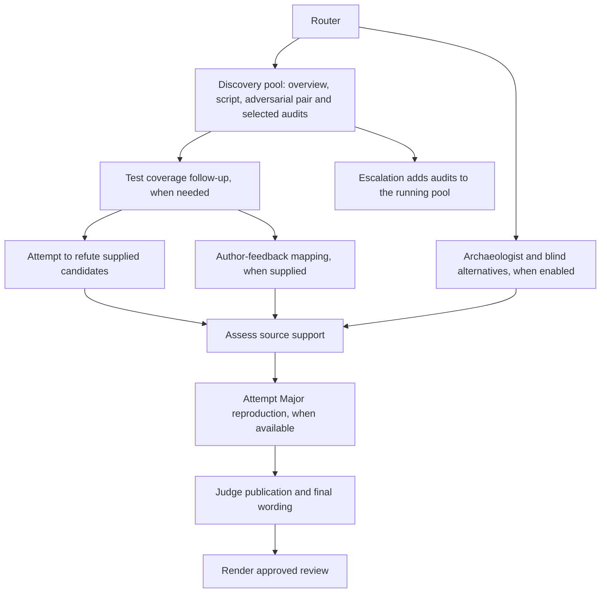

# Agent flow

Ralph discovers candidate findings, finishes a bounded test-coverage follow-up
when needed, challenges the candidates, verifies their source support, and
submits eligible findings to a final judge. Only the judge decides publication
and writes the final wording. Optional experiments can investigate supported
Major findings before that decision.

## How agents are selected

The [router](router/prompt.md) proposes a review tier, focused audits and
adversarial domains from changed behavior. Path rules add matching specialist
audits without forcing a tier. Discovery can expand the selection when it
finds sensitive behavior. A consensus domain or conservative fallback promotes
the remaining review to the high settings profile. Explicit stage overrides
still apply. Comment-only changes in a consensus file do not automatically
select the consensus domain.

The [independent](independent/prompt.md) agent reviews the overall change.
Specialists cover script, concurrency, state, public contracts, build changes,
tests, dead code and design. Discovery agents run concurrently in a bounded
pool and never receive each other's output; pooled candidates keep a fixed
stage order. Sensitive reviews add the two adversarial reviewers. They share a
[prompt](adversarial/prompt.md) with selected consensus, wallet or P2P
[domain instructions](adversarial/domains).

Archaeology runs only when enabled with PR context and discussion evidence.
Blind alternatives see the problem, goal and baseline code, not the proposed
solution or discussion. Backport reviews skip blind alternatives. Neither
research result can stop the selected code-review stages.

### Routing modes and specialists

| Selection or escalation | Result |
| --- | --- |
| Enabled routing | Use the semantic tier and profiles; add mandatory specialist audits from paths. |
| Explicit full mode | Select every audit and profile, including script. |
| Shadow mode | Record the routing proposal, then select every audit and profile, including script. This also applies after routing fallback. |
| Invalid or failed routing, material missing context, or oversized patch | Use the sensitive general plan with all profiles, excluding script. Full and shadow modes still include script. Provider or stage failures remain explicit. |
| Overview requests sensitive review from a lower tier | Add all general audits and profiles, excluding script. |
| A focused audit requests sensitive review from a lower tier | Add adversarial, state and concurrency; keep selected profiles, or use all profiles if none were selected. |
| Consensus domain or conservative fallback | Promote remaining stages to high settings, preserving explicit stage overrides. |

Path rules add required audits for tests, production code, synchronization,
storage, public interfaces, build files and GUI changes. See
[routing.py](../ralph/routing.py) for the exact path rules. Documentation paths
are excluded from directory-based coverage; the router may still select audits
for substantive documentation changes. An empty audit list does not skip the
independent review.

The [script specialist](script/prompt.md) handles substantive script execution,
signatures, spend acceptance and transaction-policy changes. Sensitive tier,
filenames, generic missing context and routing fallback do not select it.
Full and shadow modes include it. Its candidates use the same verification
path as other findings.

The [symbol-usage audit](symbol_usage/prompt.md) checks new unused code and
references orphaned by removals or renames, including in unchanged files.
Reviewers must account for indirect uses, supported configurations, external
contracts and side effects before recommending deletion. The design audit
checks explanations of behavior and rationale. Documentation that names code
can warrant either audit; spelling and formatting alone need neither.

## Test coverage and large changes

Large inputs include every changed path and its size, with commit-to-path
mapping and bounded excerpts shared across files. Each reviewer must account
for the behaviors assigned to its responsibility, including omitted excerpts.
Generated data and mechanical changes need a justified inspection strategy.
Reading an excerpt alone does not establish complete review.

The [tests](tests/prompt.md) agent groups required paths by behavior and returns
`test_coverage` with paths, status, exact evidence, a distinguishing regression,
and a reason. Checked means the implementation and relevant assertions were
inspected; it can include a confirmed missing assertion. Deferred means the
inspection is unfinished. Not-applicable needs a concrete reason.

One `tests_followup` pass starts as soon as tests completes when required
paths remain omitted or deferred, while other audits may still run. It reuses the tests
prompt and resolved settings. It receives the remaining assignments and prior
assessments and candidates. It does not repeat the whole review. Checked
assignments from both passes are combined; original model replies and their
limitations remain in the trace. Unfinished work stays a visible coverage
limitation after this bounded follow-up. There is no separate follow-up agent
directory.

## Challenge, verify and judge

The [challenger](challenger/prompt.md) attempts to refute every supplied
candidate. Its outcomes are `refuted`, `not_refuted`, or `unresolved`, with exact
source evidence required for a refutation. It cannot add candidates, remove
ones it dislikes, assign severity, or decide publication. All candidates
continue to the verifier, including those challenged successfully.

The [verifier](verifier/prompt.md) assesses every candidate against immutable
source. Its code decisions are `supported`, `refuted`, or `unresolved`.
Supported findings become eligible for the judge. It assigns their kind,
severity, security assessment, location, and supporting evidence. Concept
assessment remains separate. [Reconciliation](verifier/reconciliation.md)
checks earlier findings against current source when supplied.

The [write-verifier](write_verifier/prompt.md) may attempt reproduction of
supported Major findings in an isolated disposable workspace. Each experiment
starts from clean pinned source. It records commands, source patches, and
results; it does not decide publication. An unavailable or inconclusive
experiment does not invalidate a static proof.

The [judge](judge/prompt.md) runs when supported findings or an eligible concept
objection remain. It independently checks eligible findings, rebuttals,
and optional experiment evidence. It returns `publish`, `drop`, or `unresolved`
for each eligible finding and writes approved titles, summaries and bodies.
Every publication requires exact source evidence. The judge cannot add or merge
findings, resurrect ineligible candidates, or change kind, severity, security,
or location. It may also approve and summarize an eligible concept objection.
No model edits its approved wording afterward.

Failed verification withholds unsupported findings. A failed or invalid judge
response withholds pending findings; there is no wording fallback. The
[comment templates](../final_comment/README.md) render approved output and
coverage limitations. The shared [finding format](shared/finding-format.md)
applies to the verifier's proposed text and the judge's final wording.

For settings, complete custom agent directories and local checks, see
[Contributing](../CONTRIBUTING.md). For export contracts and detailed failure
handling, see the [engine reference](../docs/engine.md).
