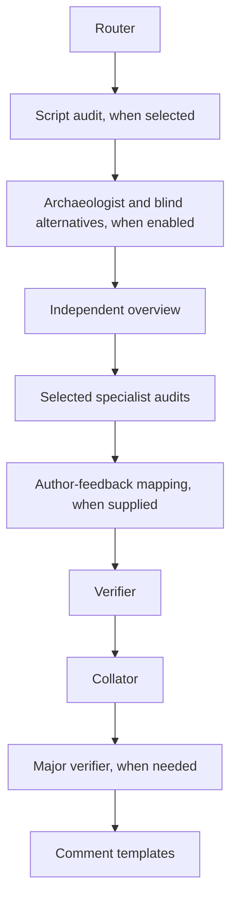

# Agent flow

Ralph gathers candidate findings in independent passes, verifies them against
source, then edits and formats the accepted findings. Reviews are static; agents
do not build or execute the code under review.

## How agents are selected

The [router](router/prompt.md) proposes a review tier, focused audits and
adversarial domains from changed behavior, using bounded base/head code reads
when needed. Path rules add mandatory specialist audits without forcing a tier
or adversarial profile. Discovery can expand the selection when it finds a
sensitive area that needs more review.

The [independent](independent/prompt.md) agent reviews the overall change.
Specialists cover script, concurrency, state, public contracts, build changes,
tests, dead code and design. When selected, the script audit runs first.
Sensitive reviews also run the two adversarial reviewers concurrently. They
share a [prompt](adversarial/prompt.md), with relevant consensus, wallet or P2P
[domain instructions](adversarial/domains).

Archaeology runs only when enabled with PR context and discussion evidence.
Its blind-alternatives agent sees the problem, goal and baseline, and can inspect
only the comparison-base code. It does not see the proposed solution. Backport
reviews skip blind alternatives.

An unusable routing result selects the sensitive general audits. Full mode
runs every audit. Shadow mode records the router's proposal and runs every audit.
These choices live in [routing.py](../ralph/routing.py); scheduling lives in
[pipeline.py](../ralph/pipeline.py).

## How verification works

The [verifier](verifier/prompt.md) receives the candidate findings and any
concept assessment, alternatives or earlier findings. It checks the evidence
and decides which claims to publish, drop or leave unresolved. Python validates
candidate references, locations and source excerpts before accepting results.
When earlier findings exist, [reconciliation](verifier/reconciliation.md) checks
whether they still hold; an author's disagreement alone cannot dismiss them.

The [collator](collator/prompt.md) edits accepted wording without repository
access. It must preserve finding IDs, locations and the accepted claims.
Findings classified as Major then receive a second source check from the
[major verifier](major_verifier/prompt.md), using their final public wording.

Failed verification withholds unverified findings. Failed editing falls back to
verified wording. A failed Major check withholds the pending Major findings.
The [comment templates](../final_comment/README.md) arrange the surviving output
and show any review limitations.

For prompt edits, settings and local checks, see [Contributing](../CONTRIBUTING.md).
