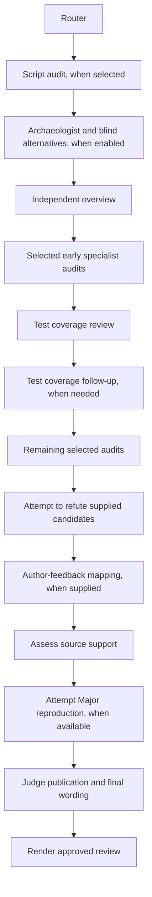

# Agent flow

Ralph discovers candidate findings, finishes a bounded test-coverage follow-up
when needed, challenges the candidates, verifies their source support, and
submits eligible findings to a final judge. Only the judge decides publication
and writes the final wording. Optional experiments can investigate supported
Major findings before that decision.

## How agents are selected

The [router](router/prompt.md) proposes a review tier, focused audits and
adversarial domains from changed behavior. Path rules add matching specialist
audits without forcing a tier. Discovery can expand the selection when it
finds sensitive behavior. A consensus domain or conservative fallback promotes
the remaining review to the high settings profile. Explicit stage overrides
still apply. Comment-only changes in a consensus file do not automatically
select the consensus domain.

The [independent](independent/prompt.md) agent reviews the overall change.
Specialists cover script, concurrency, state, public contracts, build changes,
tests, dead code and design. When selected, the script audit runs first.
Sensitive reviews run the two adversarial reviewers concurrently. They share a
[prompt](adversarial/prompt.md) with selected consensus, wallet or P2P
[domain instructions](adversarial/domains).

Archaeology runs only when enabled with PR context and discussion evidence.
Blind alternatives see the problem, goal and baseline code, not the proposed
solution or discussion. Backport reviews skip blind alternatives. Neither
research result can stop the selected code-review stages.

## Test coverage and large changes

Large inputs include every changed path and its size, with commit-to-path
mapping and bounded excerpts shared across files. Each reviewer must account
for the behaviors assigned to its responsibility, including omitted excerpts.
Generated data and mechanical changes need a justified inspection strategy.
Reading an excerpt alone does not establish complete review.

The [tests](tests/prompt.md) agent groups required paths by behavior and returns
`test_coverage` with paths, status, exact evidence, a distinguishing regression,
and a reason. Checked means the implementation and relevant assertions were
inspected; it can include a confirmed missing assertion. Deferred means the
inspection is unfinished. Not-applicable needs a concrete reason.

One `tests_followup` pass runs immediately after tests when required paths
remain omitted or deferred, before later discovery audits. It reuses the tests
prompt and resolved settings. It receives the remaining assignments and prior
assessments and candidates. It does not repeat the whole review. Checked
assignments from both passes are combined; original model replies and their
limitations remain in the trace. Unfinished work stays a visible coverage
limitation after this bounded follow-up. There is no separate follow-up agent
directory.

## Challenge, verify and judge

The [challenger](challenger/prompt.md) attempts to refute every supplied
candidate. Its outcomes are `refuted`, `not_refuted`, or `unresolved`, with exact
source evidence required for a refutation. It cannot add candidates, remove
ones it dislikes, assign severity, or decide publication. All candidates
continue to the verifier, including those challenged successfully.

The [verifier](verifier/prompt.md) assesses every candidate against immutable
source. Its code decisions are `supported`, `refuted`, or `unresolved`.
Supported findings become eligible for the judge. It assigns their kind,
severity, security assessment, location, and supporting evidence. Concept
assessment remains separate. [Reconciliation](verifier/reconciliation.md)
checks earlier findings against current source when supplied.

The [write-verifier](write_verifier/prompt.md) may attempt reproduction of
supported Major findings in an isolated disposable workspace. Each experiment
starts from clean pinned source. It records commands, source patches, and
results; it does not decide publication. An unavailable or inconclusive
experiment does not invalidate a static proof.

The [judge](judge/prompt.md) runs when supported findings or an eligible concept
objection remain. It independently checks eligible findings, rebuttals,
and optional experiment evidence. It returns `publish`, `drop`, or `unresolved`
for each eligible finding and writes approved titles, summaries and bodies.
Every publication requires exact source evidence. The judge cannot add or merge
findings, resurrect ineligible candidates, or change kind, severity, security,
or location. It may also approve and summarize an eligible concept objection.
No model edits its approved wording afterward.

Failed verification withholds unsupported findings. A failed or invalid judge
response withholds pending findings; there is no wording fallback. The
[comment templates](../final_comment/README.md) render approved output and
coverage limitations. The shared [finding format](shared/finding-format.md)
applies to the verifier's proposed text and the judge's final wording.

Custom agent directories need `judge`; `collator` and `major_verifier` are
removed. Older frozen configurations require fresh configuration and recapture.
For settings and local checks, see [Contributing](../CONTRIBUTING.md).
